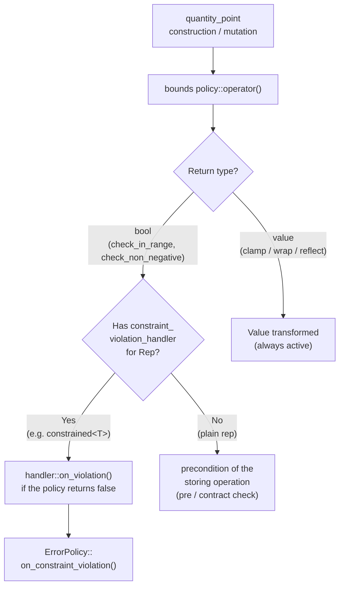

# Ensure Ultimate Safety

This guide shows how to combine **mp-units** safety features to get guaranteed,
always-on constraint enforcement for your quantities — independent of build mode
or compiler optimization level.

!!! tip "Background reading"

    For in-depth background on how bounds policies and overflow handling work, see
    [Range-Validated Quantity Points](../../blog/posts/range-validated-quantity-points.md).

## The Problem

With a plain representation type, a checking policy such as `check_in_range` makes the
bounds a [precondition](../../users_guide/framework_basics/the_affine_space.md#available-overflow-policies)
of the operation that stores a value. Whether that precondition is checked depends on the
[contract configuration](../integration/wide_compatibility.md#contract-checking-macros) of
the build. This is fine for catching logic errors during development, but some domains
need **guaranteed enforcement**:

- Safety-critical systems (aviation, medical, automotive)
- Input validation at system boundaries
- Financial calculations with strict ranges

## The Solution

The library provides building blocks that work together:

<!-- markdownlint-disable MD013 -->
1. [**Bounds on point origins**](../../users_guide/framework_basics/the_affine_space.md#range-validated-quantity-points) —
   a bounds policy passed as a template parameter to a point origin, enforcing validation
   on every construction and mutation
2. **`constrained<T, ErrorPolicy>`** — a transparent wrapper that tags a representation
   type with an error policy
3. [**`constraint_violation_handler<Rep>`**](../../users_guide/advanced_topics/representation_types.md#constraint-violation-handler) —
   a customization point that library features query to dispatch errors
<!-- markdownlint-enable MD013 -->

The library ships [several overflow policies](../../users_guide/framework_basics/the_affine_space.md#available-overflow-policies)
to pass as bounds template parameters: `check_in_range`, `clamp_to_range`, `wrap_to_range`,
and `reflect_in_range`. This guide uses the checking policy `check_in_range` with a
representation type that has a `constraint_violation_handler`. The library invokes that
handler on every violation in every build mode, and the handler chooses what happens next.

### Step 1: Choose an Error Policy

The library ships two error policies in `<mp-units/constrained.h>`:

| Policy             | Availability                    | Behavior                   |
|--------------------|---------------------------------|----------------------------|
| `throw_policy`     | Hosted, with exceptions enabled | Throws `std::domain_error` |
| `terminate_policy` | Always                          | Calls `std::abort()`       |

You can also write your own:

```cpp
struct log_and_continue_policy {
  static void on_constraint_violation(std::string_view msg) {
    spdlog::error("Constraint violation: {}", msg);
  }
};
```

### Step 2: Use `constrained<T, Policy>` as Your Representation Type

Wrap your numeric type with the desired policy:

```cpp
#include <mp-units/utility/constrained.h>

using safe_double = mp_units::utility::constrained<double, mp_units::utility::throw_policy>;
```

`constrained<T>` is transparent: it implicitly converts to/from `T` and forwards all
arithmetic. But it carries the error policy as a compile-time tag that the library can detect.

The library automatically registers a `constraint_violation_handler` for every
`constrained<T, EP>` instantiation, forwarding violations to `EP::on_constraint_violation()`.

### Step 3: Pass Bounds to Your Origin

Pass a bounds policy as a template parameter to your origin.
For guaranteed enforcement, use `check_in_range`:

```cpp
#include <mp-units/overflow_policies.h>
#include <mp-units/framework.h>
#include <mp-units/systems/si.h>

using namespace mp_units;
using namespace mp_units::utility;
using namespace mp_units::si::unit_symbols;

inline constexpr struct geo_latitude : quantity_spec<isq::angular_measure> {} geo_latitude;
inline constexpr struct equator :
    absolute_point_origin<geo_latitude, check_in_range{-90 * deg, 90 * deg}> {} equator;
```

### Step 4: Combine Them

Use `constrained<T>` as the representation type in your quantity point, and validate a
reading with `try_make` before the point exists:

```cpp
using latitude = quantity_point<geo_latitude[deg], equator, safe_double>;

std::expected<latitude, bounds_violation> read_latitude(double raw_lat)
{
  return try_make<latitude>(raw_lat * deg, equator);
}
```

An invalid reading comes back as `bounds_violation`, and no exception is thrown. The
representation is the safety net for a violation nobody tested for, for example in
arithmetic on a valid point. When `check_in_range` rejects such a value, the library finds
the `constraint_violation_handler<constrained<double, throw_policy>>` specialization and
calls `throw_policy::on_constraint_violation("value out of bounds")`, which throws
`std::domain_error`. This happens in **every** build mode: debug, release, or
release-with-debug-info.

### Without Exceptions or Before C++23

Code built without exceptions cannot use `throw_policy`. Use `terminate_policy` as the safety
net instead. The validation doesn't change, because `try_make` never passes a rejected value
to the representation. Before C++23, where `try_make` isn't available, `is_within_bounds`
applies the same test:

```cpp
using checked_double = constrained<double, terminate_policy>;
using checked_latitude = quantity_point<geo_latitude[deg], equator, checked_double>;

std::optional<checked_latitude> read_latitude(double raw_lat)
{
  if (!is_within_bounds<checked_latitude>(raw_lat * deg, equator)) return std::nullopt;
  return checked_latitude{raw_lat * deg, equator};
}
```

Both functions reject a NaN reading. See
[Validating Untrusted Values](../../users_guide/framework_basics/the_affine_space.md#validating-untrusted-values)
for the rules they follow.

!!! tip "Extensible policy interface"

    The origin bounds template parameter takes any policy that follows the interface
    described in
    [Available Overflow Policies](../../users_guide/framework_basics/the_affine_space.md#available-overflow-policies),
    which also covers `exclusive_bound`. The library ships six built-in policies — `check_in_range`,
    `clamp_to_range`, `wrap_to_range`, `reflect_in_range`, `check_non_negative`, and
    `clamp_non_negative` — and the interface is fully extensible. `check_non_negative` and
    `clamp_non_negative` cover the common `[0, +∞)` halfline case; they are also applied
    automatically to natural origins of non-negative ISQ quantity specs. For a fully custom
    one-sided or asymmetric policy, see [Custom Policies](../../users_guide/framework_basics/the_affine_space.md#custom-policies-one-sided-bounds).
    A user-defined checking policy also gets `is_within_bounds` and `try_make`.

## How It Works



## Bringing Your Own Handler

You don't have to use `constrained<T>` — any representation type can opt in by specializing
`constraint_violation_handler`:

```cpp
// Your custom safe-double type
class my_safe_double { /* ... */ };

template<>
struct mp_units::constraint_violation_handler<my_safe_double> {
  static void on_violation(std::string_view msg)
  {
    throw std::domain_error(std::string(msg));
  }
};
```

Now the library uses your handler whenever a checking policy, such as `check_in_range`,
rejects the value of a `quantity_point` with `my_safe_double` rep.

## Combining with `safe_int`

For integer quantities, the library provides `safe_int<T>` in `<mp-units/safe_int.h>`,
which detects arithmetic overflow. You can use both together:

```cpp
#include <mp-units/utility/safe_int.h>

// Overflow-detecting integer for arithmetic operations
quantity distance = safe_int{42} * m;  // arithmetic overflow detected at runtime

// Bounded quantity point with overflow-detecting rep
using altitude = quantity_point<isq::height[m], msl_origin, safe_int<int>>;

// Convenience aliases are available for common integer types
quantity speed = safe_i32{100} * (m / s);
```

`safe_int` also specializes `constraint_violation_handler`, so a `check_in_range`
violation goes through its error policy.

## See Also

<!-- markdownlint-disable MD013 -->
- [`safe_int<T>`](../../users_guide/framework_basics/safe_int.md) —
  overflow-safe integer arithmetic reference
- [Preventing Integer Overflow in Physical Computations](../../blog/posts/preventing-integer-overflow.md) —
  in-depth narrative on automatic scaling overflow, design tradeoffs, and comparison with Au
- [Representation Types](../../users_guide/advanced_topics/representation_types.md) —
  `constraint_violation_handler` reference
- [Range-Validated Quantity Points](../../users_guide/framework_basics/the_affine_space.md#range-validated-quantity-points) —
  overflow policies reference
- [Using Custom Representation Types](../integration/using_custom_representation_types.md) —
  creating your own rep types
<!-- markdownlint-enable MD013 -->
