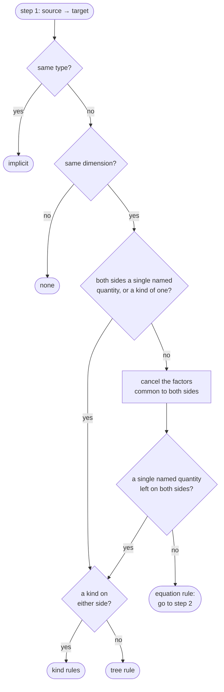
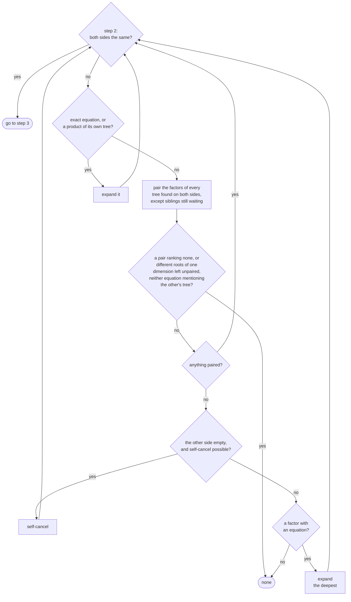
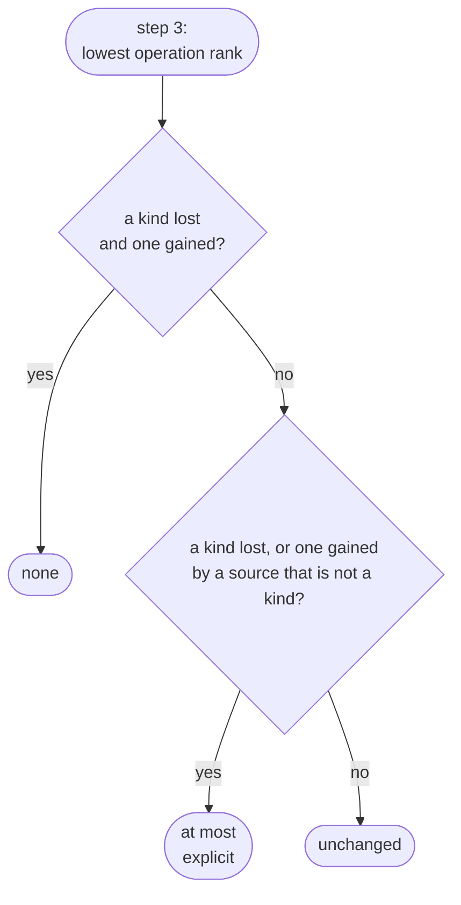

# Quantity Specification Conversions

Every time a quantity is copied into a differently typed one, passed through the call
operator of a quantity specification, or put through `quantity_cast`, the library has to
answer one question: how are these two quantity specifications related? The answer decides
whether the code compiles as written, needs an explicit conversion, needs a cast, or is
rejected altogether.

[Systems of Quantities](../framework_basics/systems_of_quantities.md#converting-between-quantities)
shows the four outcomes on the _length_ hierarchy, which is all that everyday code needs.
This chapter gives the complete rules, including what happens when quantity equations and
quantity kinds are involved.


## Vocabulary

A quantity specification comes in one of three shapes:

- A **named quantity** is defined with `quantity_spec`. It has a dimension, an optional
    **parent**, an optional **equation**, and may be marked with `is_kind`.
- A **derived quantity** is a product of powers of named quantities, such as
    `isq::mass * pow<2>(isq::length) / pow<2>(isq::time)`. The library keeps it
    normalized, so equal names are merged, zero exponents disappear, and `dimensionless`
    is the identity (`isq::length / isq::length` _is_ `dimensionless`, while
    `isq::width / isq::length` stays a derived quantity). A factor may itself be a kind,
    spelled `kind_of_<K>`, when a kind and a typed quantity met in one equation (see
    [Kinds](#kinds)).
- A **kind**, spelled `kind_of<K>`, where `K` is a named quantity that is its own kind
    root, or a product of such quantities, stands for any quantity of the hierarchy below
    `K`. This is what a bare unit carries: `42 * m` has the quantity specification
    `kind_of<isq::length>`.

The rules refer to a few facts about a named quantity:

- Its **tree** is the chain of parents. The **root** is the top of that chain. Two named
    quantities are in the same tree when they share a root.
- Its **kind root** is the nearest quantity on the way up, itself included, that was
    declared with `is_kind`. If there is none, the kind root is the root. A quantity
    declared with `is_kind` is a **declared kind**. _Angular measure_ and _storage
    capacity_ are the usual examples, see
    [Nested quantity kinds](../framework_basics/dimensionless_quantities.md#nested-quantity-kinds).
- Its **equation** is the one given in its definition or, if none was given, its parent's,
    recursively. A base quantity has none. A quantity **defines** its equation when it has
    one that it didn't take over from its parent: it is a root, its parent has no
    equation, or its equation differs from its parent's. A child that restates its
    parent's equation doesn't define it. The **defining ancestor** of a quantity is the
    nearest quantity on the way up, itself included, that defines the equation the
    quantity has. `dimensionless` is a root whose equation is the empty product, so
    _rotation_, a child of `dimensionless` without an equation of its own, has
    `dimensionless` as its defining ancestor.
- Its **depth** says how many levels of equations lie below it. A quantity with no
    equation at all, such as a base quantity, has depth `0`. A quantity with an equation
    has depth one more than the deepest factor of that equation, so _speed_
    (`length / duration`) has depth `1` and _acceleration_ (`velocity / duration`) has
    depth `2`. The empty product is an equation too, one without factors, so
    `dimensionless` and _rotation_, which takes it over, have depth `1`. A derived
    quantity has the depth of its deepest factor.
- Its **carried kinds** are the declared kinds it carries, each with a count that may be
    negative or fractional. The count comes from two places. First, the quantity itself
    and every quantity on its way up count once each if they are declared kinds, so _phase
    angle_ carries _phase angle_ once and _angular measure_ once. Second, every factor of
    its equation adds its own carried kinds multiplied by the factor's exponent, so a
    factor in a denominator subtracts. _Angular velocity_, defined over an angular
    displacement, carries _angular measure_ once this way. Counts of one kind add up and a
    count of zero is dropped, so _speed_ carries nothing. A derived quantity carries the
    sum over its factors:
    `isq::angular_velocity * isq::radius / isq::angular_measure / isq::speed` carries
    nothing: its numerator angle and its denominator angle cancel.

For the definitions below, where `dimensionless` is the library's own:

```cpp
inline constexpr struct length : quantity_spec<dim_length> {} length;
inline constexpr struct width : quantity_spec<length> {} width;
inline constexpr struct radius : quantity_spec<width> {} radius;
inline constexpr struct path_length : quantity_spec<length> {} path_length;
inline constexpr auto arc_length = path_length;
inline constexpr struct duration : quantity_spec<dim_time> {} duration;
inline constexpr struct mass : quantity_spec<dim_mass> {} mass;
inline constexpr struct speed : quantity_spec<length / duration> {} speed;
inline constexpr struct special_speed : quantity_spec<speed> {} special_speed;
inline constexpr struct displacement : quantity_spec<length, quantity_tensor_order::vector> {} displacement;
inline constexpr struct velocity : quantity_spec<speed, displacement / duration> {} velocity;
inline constexpr struct acceleration : quantity_spec<velocity / duration> {} acceleration;
inline constexpr struct force : quantity_spec<mass * acceleration> {} force;
inline constexpr struct angular_measure : quantity_spec<dimensionless, arc_length / radius, is_kind> {} angular_measure;
inline constexpr struct phase_angle : quantity_spec<angular_measure, is_kind> {} phase_angle;
inline constexpr struct rotational_displacement : quantity_spec<angular_measure, path_length / radius> {} rotational_displacement;
inline constexpr struct rotation : quantity_spec<dimensionless> {} rotation;
```

the facts are:

| Quantity                  | Root            | Kind root         | Equation                  | Defining ancestor | Depth | Carried kinds                    |
|---------------------------|-----------------|-------------------|---------------------------|-------------------|-------|----------------------------------|
| `width`                   | `length`        | `length`          | none                      | none              | 0     | none                             |
| `speed`                   | `speed`         | `speed`           | `length / duration`       | `speed`           | 1     | none                             |
| `special_speed`           | `speed`         | `speed`           | `length / duration`       | `speed`           | 1     | none                             |
| `velocity`                | `speed`         | `speed`           | `displacement / duration` | `velocity`        | 1     | none                             |
| `acceleration`            | `acceleration`  | `acceleration`    | `velocity / duration`     | `acceleration`    | 2     | none                             |
| `force`                   | `force`         | `force`           | `mass * acceleration`     | `force`           | 3     | none                             |
| `angular_measure`         | `dimensionless` | `angular_measure` | `arc_length / radius`     | `angular_measure` | 1     | `angular_measure`                |
| `phase_angle`             | `dimensionless` | `phase_angle`     | `arc_length / radius`     | `angular_measure` | 1     | `phase_angle`, `angular_measure` |
| `rotational_displacement` | `dimensionless` | `angular_measure` | `path_length / radius`    | `angular_measure` | 1     | `angular_measure`                |
| `rotation`                | `dimensionless` | `dimensionless`   | (empty)                   | `dimensionless`   | 1     | none                             |

_Special speed_ and _phase angle_ take their equation over from the parent, and
_rotational displacement_ restates its parent's (`path_length` is `arc_length`), so none of
the three defines one. _Force_ has depth 3 because its equation reaches _acceleration_,
whose equation reaches _velocity_.

The character of a quantity plays no part in these rules.


## Outcomes

A conversion gets one of four ranks, ordered from worst to best:

| Rank       | Meaning                                                                                                      |
|------------|--------------------------------------------------------------------------------------------------------------|
| `none`     | the quantities have nothing in common                                                                        |
| `cast`     | same kind, different branches (`quantity_cast` is required)                                                  |
| `explicit` | the target is more specific than the source, or a declared kind is lost or gained                            |
| `implicit` | every source quantity is a target quantity, or the source is an uncommitted kind that the target specializes |

`utility::implicitly_convertible()` is `true` for `implicit`,
`utility::explicitly_convertible()` for `implicit` and `explicit`, and
`utility::castable()` for all but `none`.

A conversion is `explicit` for one of two reasons: the target is more specific than
the source (a downcast), or the conversion drops or gains a declared kind. The two
reasons lead to the same rank with one exception, a source that is a kind, such as the
`kind_of<isq::length>` that `42 * m` carries (see [Kinds](#kinds)). A kind hasn't
committed to any quantity of its tree yet, so a downcast from it takes nothing away and is
`implicit`: `kind_of<inverse(isq::time)>` converts to `isq::frequency` implicitly.
Dropping a declared kind loses the kind whatever the source is, so
`kind_of<isq::angular_measure / isq::time>` to `dimensionless / isq::time` stays
`explicit`.

A conversion is decided by a sequence of operations, described below. Each operation has a
rank, and the conversion gets the lowest of them: `inverse(isq::time)` to `isq::frequency`
expands _frequency_ with `implicit` and pairs `time` with `period_duration`, which ranks
`explicit`, so the conversion is `explicit`. When the operations can be applied in more
than one way, the conversion gets the best rank over all of them.


## Overview of the process

The process runs in up to three steps. Step 1 picks the rule that applies. Between two
single named quantities, or a named quantity and a kind, the tree rule or the kind rules
decide the rank on their own. When a derived quantity is involved, the factors common to
both sides cancel first. If a single named quantity is left on each side, the same rules
decide. Otherwise the equation rule continues with steps 2 and 3, with `K` in place of a
kind `kind_of<K>`:



Step 2 makes one operation at a time. After each operation it starts again from the top,
until both sides are the same: both empty, or the same product right after an exact
equation:



Step 3 takes the lowest rank of the operations made in step 2, and the kind boundary may
lower it:



## Checks that come first

Identical quantity specifications convert with `implicit`. Quantity specifications of different
dimensions never convert, and `quantity_cast` won't force them either:

```cpp
static_assert(!utility::castable(isq::time, isq::length));
```

Everything below assumes equal dimensions.


## Kinds

A kind `kind_of<K>` names a quantity somewhere in the tree below the kind root `K` without
saying where. A conversion between a kind of a named quantity and a named quantity never
ranks `cast`.

When the source is a kind, the target is `implicit` if it lies in the tree below `K`,
sub-kinds included, unless its equation lacks a declared kind that `K` carries, which
makes it `explicit`. A child of _angular velocity_ defined as `inverse(duration)` is
reached only explicitly. If the target is above `K`, the kind has to leave its declared
kind and the rank is `explicit`. Anything else is `none`:

```cpp
static_assert(utility::implicitly_convertible(kind_of<isq::length>, isq::width));
static_assert(utility::implicitly_convertible(kind_of<dimensionless>, isq::angular_measure));
static_assert(!utility::implicitly_convertible(kind_of<isq::angular_measure>, dimensionless));
static_assert(utility::explicitly_convertible(kind_of<isq::angular_measure>, dimensionless));
static_assert(!utility::castable(kind_of<isq::frequency>, isq::activity));
```

This is why `quantity<isq::height[m]> tower_height = 42 * m;` compiles: the right-hand
side is a quantity of kind _length_ and _height_ is a _length_.

When the target is a kind, asking for "any quantity of kind `K`" is the same as asking for
`K` itself. A source below `K` is `implicit`, or `explicit` if one of them carries a
declared kind the other doesn't, lying on the way up, the source included and `K`
excluded, or carried by an equation. A source above `K` is `explicit`, like any other
downcast. Any other source, from another branch of the same tree or from a different
tree, is `none`:

```cpp
static_assert(utility::implicitly_convertible(isq::width, kind_of<isq::length>));
static_assert(utility::explicitly_convertible(isq::angular_measure, kind_of<dimensionless>));
static_assert(!utility::implicitly_convertible(isq::angular_measure, kind_of<dimensionless>));
static_assert(utility::explicitly_convertible(dimensionless, kind_of<isq::angular_measure>));
static_assert(!utility::implicitly_convertible(dimensionless, kind_of<isq::angular_measure>));
```

When a derived quantity is involved, the equation rules below run with `K` in place of the
kind. Every downcast step from a source kind ranks `implicit`, while dropping a declared
kind stays `explicit`:

```cpp
static_assert(utility::implicitly_convertible(kind_of<inverse(isq::time)>, isq::frequency));
static_assert(utility::explicitly_convertible(inverse(isq::time), kind_of<isq::frequency>));
static_assert(!utility::implicitly_convertible(inverse(isq::time), kind_of<isq::frequency>));
```

The first line against the last two shows the asymmetry. `1 / (2 * s)` is a kind and
becomes a _frequency_ implicitly. `1 / isq::time(2 * s)` is a typed `inverse(time)`, and
_frequency_ is defined over _period duration_, so this one needs `isq::frequency(...)`.

A kind that meets a typed quantity in one equation stays a kind factor of the result,
spelled `kind_of_<K>` inside the derived quantity, and the typed factor stays typed. The
rules above then apply to each factor on its own: a kind factor on the source side
converts as a kind does, a kind factor on the target side pairs as `K` does, and a kind
factor and a typed factor of one tree are different factors, like `isq::width` and
`isq::length`:

```cpp
inline constexpr struct rate_of_climb : quantity_spec<isq::speed, isq::height / isq::duration> {} rate_of_climb;

static_assert(utility::implicitly_convertible(kind_of<isq::length> / isq::duration, rate_of_climb));
static_assert(!utility::implicitly_convertible(isq::length / isq::duration, rate_of_climb));
static_assert(utility::implicitly_convertible(isq::height / kind_of<isq::duration>, isq::height / isq::period_duration));
static_assert(!utility::implicitly_convertible(isq::height / isq::duration, isq::height / isq::period_duration));
static_assert(utility::implicitly_convertible(kind_of<isq::length> / isq::length, dimensionless));
static_assert(utility::implicitly_convertible(kind_of<isq::length> * isq::length, isq::height * isq::length));
static_assert(!utility::implicitly_convertible(pow<2>(isq::length), isq::height * isq::length));
```

The first two lines are `42 * m / isq::duration(2 * s)` against
`isq::length(42 * m) / isq::duration(2 * s)`: only the first may be a _rate of climb_
because only the first has a kind for its _length_. The fifth line is the ratio of two
lengths, and the last two keep the product apart against the merged `pow<2>(isq::length)`.
Only a result whose factors are all kinds is a kind itself,
`kind_of<isq::length / isq::duration>` for `42 * m / (2 * s)`.


## Two named quantities

Between two named quantities their positions in the hierarchy decide. Equations are
consulted only for the declared kinds they carry. The kind boundary described in
[Derived quantities](#derived-quantities) lowers the rank of every rule below where a
declared kind is lost or gained.

1. Different trees: `none`. _Frequency_ and _activity_ both have the dimension of inverse
   time and have nothing in common.
2. The source is a descendant of the target: `implicit`, unless one carries a declared
   kind the other doesn't, which makes it `explicit`. A kind the source carries may lie on
   the way up, the source included and the target excluded, or come from the source's
   equation: _phase coefficient_ is defined as `phase_angle / path_length`, so it carries
   a phase angle that its parent _propagation coefficient_ doesn't. The reverse happens
   too. A child defined as `inverse(duration)` under _angular velocity_ lacks the angle
   its parent's equation carries, so its upcast is `explicit` as well.
3. The target is a descendant of the source: `explicit`.
4. Neither: `cast` if both have the same kind root, otherwise `none`. Two such quantities
   that each carry a declared kind the other lacks are `none` as well.

```cpp
static_assert(!utility::castable(isq::frequency, isq::activity));                     // 1
static_assert(utility::implicitly_convertible(isq::width, isq::length));              // 2
static_assert(utility::explicitly_convertible(isq::angular_measure, dimensionless));  // 2, kind loss
static_assert(!utility::implicitly_convertible(isq::angular_measure, dimensionless));
static_assert(utility::explicitly_convertible(isq::phase_coefficient, isq::propagation_coefficient));  // 2
static_assert(!utility::implicitly_convertible(isq::phase_coefficient, isq::propagation_coefficient));
static_assert(utility::explicitly_convertible(isq::length, isq::width));              // 3
static_assert(!utility::implicitly_convertible(isq::length, isq::width));
static_assert(utility::castable(isq::height, isq::width));                            // 4
static_assert(!utility::explicitly_convertible(isq::height, isq::width));
static_assert(!utility::castable(isq::angular_measure, isq::solid_angular_measure));  // 4, different kinds
```


## Derived quantities

As soon as one side is a derived quantity, the question becomes whether the source can be
rewritten into the target. Both sides are treated as lists of factors with exponents, and
the library remembers which side each factor came from. A named quantity is a one-factor
list, `dimensionless` is the empty list.

Three operations are available. Each one removes or rewrites factors, and each has a rank.

**Pair** a source factor with a target factor from the same tree, numerator with numerator
or denominator with denominator. The common exponent is consumed and the pair ranks like
the two named quantities would. An upcast ranks `implicit`, or `explicit` when a
declared kind is left on the way. A downcast ranks `explicit`, or `implicit` when the
source is a kind, and siblings are `cast`. The direction is always source to target, so
`1 / isq::width` to `1 / isq::length` is `implicit`. A pair ranking `none` ends the
conversion with `none`.

**Self-cancel** a numerator and a denominator factor of the same dimension on the same
side. A source-side self-cancel ranks `implicit`, because a ratio of two quantities of one
dimension is a number: `height / width` or `distance / wavelength`. A target-side
self-cancel ranks `explicit`, or `implicit` when the source is a kind, because it
asserts that a number is one particular ratio, which is a downcast. A declared kind lost
on the way is handled by the kind boundary below.

**Expand** a factor into the equation of its defining ancestor. Expanding a source factor
ranks `implicit`, because every quantity satisfies its own equation, inherited or not.
Expanding a target factor ranks as the downcast from that ancestor to the factor, which is
`implicit` when they are the same quantity or the source is a kind, and `explicit`
otherwise.

**The kind boundary.** The carried kinds of the source and the target are compared by
parts, between the two sides once their common factors have canceled and independently of
the operations. For each declared kind, the numerator excess and the denominator excess are
compared separately, an absent kind counting as zero. If either part is larger on the
source side, the conversion ranks at best `explicit`, because the kind would be
lost: `1 / isq::angular_measure` to `dimensionless` loses a denominator angle. If either
part is larger on the target side, it ranks at best `explicit`, because the kind
would be gained. If a kind is lost and one gained, the conversion is `none`, as between
two unrelated kinds. This includes the same kind lost in one part and gained in the other.
A kind as the source (`kind_of<K>`, which has no position below `K` yet) is exempt from
the second cap. The comparison lowers the final rank, and the result doesn't depend on
which operations are taken:

```cpp
static_assert(!utility::implicitly_convertible(isq::arc_length / isq::radius, isq::angular_measure));
static_assert(utility::explicitly_convertible(isq::arc_length / isq::radius, isq::angular_measure));
static_assert(!utility::implicitly_convertible(isq::angular_measure * isq::radius, isq::arc_length));
static_assert(utility::explicitly_convertible(isq::angular_measure * isq::radius, isq::arc_length));
static_assert(!utility::implicitly_convertible(isq::angular_velocity / isq::frequency, dimensionless));
static_assert(utility::implicitly_convertible(isq::angular_velocity / isq::frequency, isq::angular_measure));
static_assert(utility::implicitly_convertible(kind_of<dimensionless>, isq::angular_measure));
```

The last two lines: ω / f is 2π rad, an angle, and `kind_of<dimensionless>`, the quantity
specification of a bare `3 * one`, may become any quantity of its tree, an angle included.

The rules say which operation applies when more than one could:

- **Common factors cancel first.** A factor present on both sides, in the same part, is
    canceled before any operation. The rest is then decided as if it were converted on its
    own: `isq::phase_coefficient * isq::mass` to
    `isq::propagation_coefficient * isq::mass` is `explicit`, like the bare pair.
- **Exact equation first.** If one side is a single named quantity, possibly raised to a
    power, and the other side is exactly the equation of that quantity's defining ancestor
    raised to the same power, that factor is expanded before any other operation.
    `isq::instantaneous_power * isq::duration / isq::period` to `isq::active_power` is
    such a case: both are children of _power_, and without this rule they would pair as
    siblings.
- **A product of its own tree.** A single named quantity whose equation is non-empty and
    consists only of quantities from its own tree is expanded before pairing. In the ISQ
    this happens in the `dimensionless` tree, where every pure number is a sibling of
    every other, and for `isq::intrinsic_carrier_density`, defined as
    `sqrt(electron_density * hole_density)` within the _number density_ tree. With
    `pixel_x` and `pixel_y` children of `pixel_count`, and `pixel_area` a `dimensionless`
    quantity defined as `pixel_x * pixel_y` but not a kind, `pixel_area` to
    `pixel_count * pixel_y` is `implicit` and the reverse is `explicit`, instead of both
    being cast between siblings.
- **Pairing.** Otherwise, whenever a source factor and a target factor share a tree, they
    are paired. Two factors of one tree relate by their positions in the hierarchy, not by
    their equations. A pair of siblings waits while some other factor still has an
    equation that mentions their tree, so that siblings are paired only once every factor
    of their tree is present. When a tree offers several ways to pair, the rank of the
    pairing is the best over all pairings of that tree's factors.
- **Different roots stay apart.** Two named quantities of the same dimension from
    different trees, left over after pairing, end the conversion with `none`, unless the
    equation of either mentions the other's tree, in which case the equations decide. This
    keeps roots of one dimension apart inside products: `isq::frequency * isq::width` to
    `isq::activity * isq::length` is `none`, because neither equation mentions the other's
    tree. An equation that does mention the other tree still resolves:
    `isq::radiant_intensity * isq::solid_angular_measure` to `isq::radiant_flux` is
    `implicit`.
- **Self-cancel only against an empty side.** A side may self-cancel only once the other
    side is empty. Otherwise `isq::arc_length / isq::radius` to `isq::angular_measure`
    would cancel the source into a number before the equation is used.
- **Reduce the deepest factor.** When nothing else applies, the factor with the greatest
    depth is expanded. Ties go, in this order, to the source numerator, the source
    denominator, the target numerator, the target denominator. Within that list every
    factor of that depth is tried and the best rank is kept, so the names of the
    quantities never decide the result. The factor with the greatest depth is reduced
    first, so both sides meet at the most specific common equation.

The process stops when both lists are the same: both empty, or the same product right
after an exact equation. Its rank is the lowest rank of the operations taken, or
`implicit` if no operation was needed, lowered further by the kind boundary where it
applies. It stops with `none` when a pair ranks `none`, or when factors remain and no
operation applies.

### Worked examples

Each diagram below follows one conversion through the procedure. A box shows what is left
to convert, an arrow is one operation with its rank, and the conversion gets the lowest
rank of its arrows. When the kind boundary applies, it is the last arrow, and it can only
lower the result.

??? example "`isq::width * isq::height` → `isq::area`: `implicit`"

    ```mermaid
    flowchart TD
        A["width · height → area"]
        B["width · height → length²"]
        C["height → length"]
        D["<b>implicit</b>"]
        A -->|"expand area (target, defines its equation): <b>implicit</b>"| B
        B -->|"pair width with length (upcast): <b>implicit</b>"| C
        C -->|"pair height with length (upcast): <b>implicit</b>"| D
    ```

    ```cpp
    static_assert(utility::implicitly_convertible(isq::width * isq::height, isq::area));
    ```

??? example "`isq::area` → `isq::width * isq::height`: `explicit`"

    ```mermaid
    flowchart TD
        A["area → width · height"]
        B["length² → width · height"]
        C["length → height"]
        D["<b>explicit</b>"]
        A -->|"expand area (source): <b>implicit</b>"| B
        B -->|"pair length with width (downcast): <b>explicit</b>"| C
        C -->|"pair length with height (downcast): <b>explicit</b>"| D
    ```

    ```cpp
    static_assert(!utility::implicitly_convertible(isq::area, isq::width * isq::height));
    static_assert(utility::explicitly_convertible(isq::area, isq::width * isq::height));
    ```

??? example "`inverse(isq::time)` → `isq::frequency`: `explicit`"

    `isq::time` is an alias of `isq::duration`.

    ```mermaid
    flowchart TD
        A["1 / time → frequency"]
        B["1 / time → 1 / period_duration"]
        C["<b>explicit</b>"]
        A -->|"expand frequency (target, defines its equation): <b>implicit</b>"| B
        B -->|"pair time with period_duration (downcast): <b>explicit</b>"| C
    ```

    ```cpp
    static_assert(!utility::implicitly_convertible(inverse(isq::time), isq::frequency));
    static_assert(utility::explicitly_convertible(inverse(isq::time), isq::frequency));
    ```

??? example "`isq::frequency` → `inverse(isq::time)`: `implicit`"

    ```mermaid
    flowchart TD
        A["frequency → 1 / time"]
        B["1 / period_duration → 1 / time"]
        C["<b>implicit</b>"]
        A -->|"expand frequency (source): <b>implicit</b>"| B
        B -->|"pair period_duration with time (upcast): <b>implicit</b>"| C
    ```

    ```cpp
    static_assert(utility::implicitly_convertible(isq::frequency, inverse(isq::time)));
    ```

??? example "`width / duration` → `special_speed`: `explicit`"

    An expansion on the target side isn't always `implicit`. With the names from the
    vocabulary section, _speed_ defines `length / duration`, so every length per duration
    is a _speed_ and converts to it implicitly. `special_speed` only inherits that
    equation, and not every _speed_ is a _special speed_. The equation alone can't make a
    _special speed_ implicitly, so expanding `special_speed` on the target side ranks
    `explicit`, like the downcast from _speed_.

    ```mermaid
    flowchart TD
        A["width / duration → special_speed"]
        B["width / duration → length / duration"]
        C["width → length"]
        D["<b>explicit</b>"]
        A -->|"expand special_speed (target, inherits the equation of speed): <b>explicit</b>"| B
        B -->|"pair duration with duration (same quantity): <b>implicit</b>"| C
        C -->|"pair width with length (upcast): <b>implicit</b>"| D
    ```

    The same conversion to `speed` is `implicit`, because _speed_ defines its equation:

    ```cpp
    static_assert(!utility::implicitly_convertible(width / duration, special_speed));
    static_assert(utility::explicitly_convertible(width / duration, special_speed));
    static_assert(utility::implicitly_convertible(width / duration, speed));
    ```

??? example "`inverse(isq::repetency)` → `isq::height`: `cast`"

    _Repetency_ is defined as `inverse(wavelength)`, and _wavelength_ and _height_ are
    different branches of the tree of _length_:

    ```mermaid
    flowchart TD
        A["1 / repetency → height"]
        B["wavelength → height"]
        C["<b>cast</b>"]
        A -->|"expand repetency (source): <b>implicit</b>"| B
        B -->|"pair wavelength with height (different branches): <b>cast</b>"| C
    ```

    ```cpp
    static_assert(utility::castable(inverse(isq::repetency), isq::height));
    static_assert(!utility::explicitly_convertible(inverse(isq::repetency), isq::height));
    ```

    Flattening both sides to `length` would have ranked this `explicit` and treated a
    _wavelength_ as a _height_.

??? example "`isq::angular_velocity * isq::radius / isq::speed` → `dimensionless`: `explicit`"

    In ISQ `angular_velocity` is `angular_displacement / duration`, and
    `angular_displacement` is an alias of `rotational_displacement`, which restates the
    equation `path_length / radius` of _angular measure_. Every operation is `implicit`,
    but the source carries _angular measure_ and the target carries nothing, so the kind
    boundary makes the conversion `explicit`:

    ```mermaid
    flowchart TD
        A["angular_velocity · radius / speed → dimensionless"]
        B["rotational_displacement · radius / (duration · speed) → dimensionless"]
        C["path_length / (duration · speed) → dimensionless"]
        D["path_length / length → dimensionless"]
        E["nothing left"]
        F["<b>explicit</b>"]
        A -->|"expand angular_velocity (source): <b>implicit</b>"| B
        B -->|"expand rotational_displacement (source): <b>implicit</b>, the two radius factors cancel, the source leaves the kind angular_measure, noted for the kind boundary"| C
        C -->|"expand speed (source): <b>implicit</b>, the two duration factors cancel"| D
        D -->|"self-cancel path_length against length (source): <b>implicit</b>"| E
        E -->|"kind boundary: the source left the kind angular_measure: <b>explicit</b>"| F
    ```

    ```cpp
    static_assert(!utility::implicitly_convertible(isq::angular_velocity * isq::radius / isq::speed, dimensionless));
    static_assert(utility::explicitly_convertible(isq::angular_velocity * isq::radius / isq::speed, dimensionless));
    ```

??? example "The same divided by `isq::angular_measure`: `implicit`"

    The source carries the angle once in the numerator and once in the denominator, so
    the carried kinds balance:

    ```mermaid
    flowchart TD
        A["angular_velocity · radius / (angular_measure · speed) → dimensionless"]
        B["rotational_displacement · radius / (duration · angular_measure · speed) → dimensionless"]
        C["radius / (duration · speed) → dimensionless"]
        D["radius / length → dimensionless"]
        E["nothing left"]
        F["<b>implicit</b>"]
        A -->|"expand angular_velocity (source): <b>implicit</b>"| B
        B -->|"self-cancel rotational_displacement against angular_measure (source): <b>implicit</b>, the numerator and the denominator both leave the kind angular_measure, both noted for the kind boundary"| C
        C -->|"expand speed (source): <b>implicit</b>, the two duration factors cancel"| D
        D -->|"self-cancel radius against length (source): <b>implicit</b>"| E
        E -->|"kind boundary: the source carries angular_measure in its numerator and its denominator, which cancel, so no kind is lost: <b>implicit</b>"| F
    ```

    ```cpp
    static_assert(utility::implicitly_convertible(isq::angular_velocity * isq::radius / isq::angular_measure / isq::speed,
                                         dimensionless));
    ```


## Consequences

- A factor common to both sides doesn't change how they relate: `A * X` to `B * X` is
    decided exactly as `A` to `B`, as long as no factor of `X` cancels against `A` or `B`
    (`isq::height / isq::width * isq::width` is just `isq::height`). Pairing comes before
    the equations, so if `isq::energy` converts to `isq::kinetic_energy` only explicitly,
    so does `isq::energy * isq::time / isq::period_duration` to `isq::kinetic_energy`.
- Pairing first makes reciprocal ratios of plain quantities castable:
    `isq::height / isq::width` to `isq::width / isq::height` is `cast`. A declared kind is
    different: it behaves much like a dimension, and like a dimension it doesn't convert
    to its inverse, so `isq::angular_measure` to `inverse(isq::angular_measure)` is
    `none`.
- A declared kind is a boundary in both directions. `isq::angular_measure` to
    `isq::arc_length / isq::radius` is explicit, and so is the reverse, however the
    equation is rearranged: `quantity<isq::arc_length[m]>(angle * r)`,
    `isq::angular_measure(s / r)`. The same holds for declared kinds with a dimension,
    such as a user's _fluid head_ under _height_: convert it with `isq::height(h)` before
    using it in a formula.
- Under plain `isq`, ISQ defines _torque_ and _angular momentum_ without an angle but
    _angular velocity_ with one, so `isq::torque * isq::angular_velocity` to `isq::power`
    and `isq::moment_of_inertia * pow<2>(isq::angular_velocity)` to `isq::kinetic_energy`
    are explicit. The explicit conversion also has to name a unit without the angle,
    because the call operator and `quantity_cast` accept only a unit of the target's kind,
    and `rad / s` carries the angle:

    ```cpp
    quantity power = quantity<isq::power[W]>(torque * omega);
    quantity energy = quantity<isq::kinetic_energy[J]>(inertia * pow<2>(omega));
    ```

    !!! tip

        The `isq_angle` system defines _torque_ with the angle, so there the angle cancels
        and both conversions stay implicit, provided the quantities use the `angular` units.
        See [Strong Angular System](../systems/strong_angular_system.md).

- A kind converts implicitly into sub-kinds of its tree.
    `quantity<isq::angular_measure[rad]> angle = 3 * m / (2 * m);` compiles, since
    `3 * m / (2 * m)` is a kind of _dimensionless_ and _angular measure_ sits in that
    tree.
- A named quantity is implicitly convertible from its own equation, but not from a more
    generic one. `isq::length / isq::time` converts implicitly to _speed_, and
    `inverse(isq::period_duration)` to _frequency_, while `inverse(isq::time)` converts to
    _frequency_ only explicitly. Two exceptions: a declared kind is gained implicitly only
    from a source kind, and a source kind `kind_of<K>` converts implicitly to anything
    below `K` that keeps the kinds `K` carries, so `1 / (2 * s)`, a kind of
    `inverse(isq::time)`, converts to _frequency_ implicitly.
